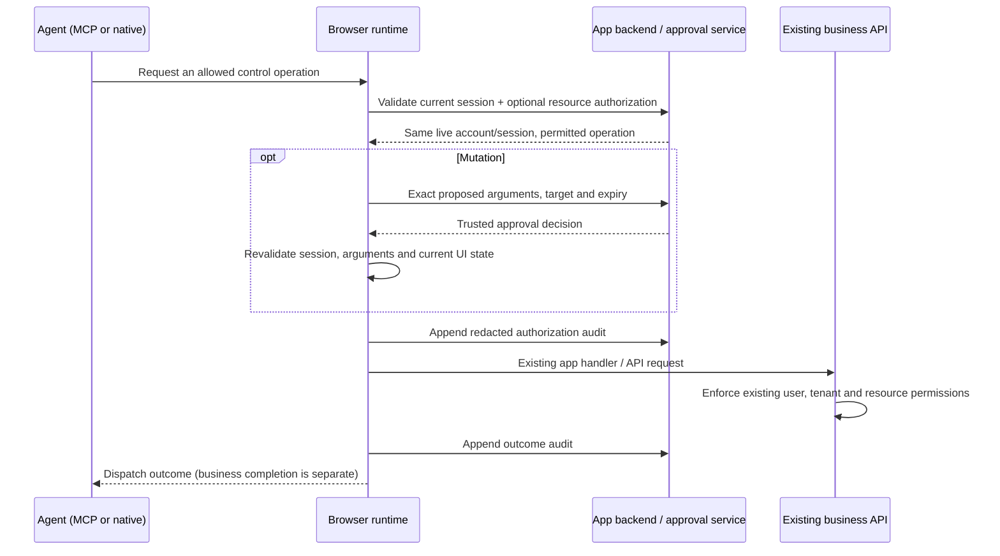

# Production access and deployment

Production mode controls which automation tools can access an app. Your existing backend still decides which account may read or change each business resource. The package supplies neither an identity provider nor your application's authorization/approval service.

This is a private alpha. Complete the app-specific setup and deployment checks below before granting access. Finite test results describe the tested workflows, not arbitrary Angular compatibility or a security certification.

## Choose a connection

| Mode | Browser bundle | Additional process | Client requirement |
| --- | --- | --- | --- |
| `mcp` | Registry + production controls | Local `serve`, or authenticated HTTP `host` | Compatible MCP client |
| `webmcp` | Registry + production controls + native publisher | None for native use | Browser and agent exposing the supported native WebMCP API |
| `both` | Both browser paths with the same access policy | Node process when using MCP | Either supported connection |

The current native publisher uses `document.modelContext` where available, with a compatibility path for an older API location. Native testing uses an actual supported Chrome build with experimental flags; this does not imply support in every stable browser, ChatGPT or Claude. The native connection does not authenticate a particular agent's identity. Apply app-session authorization and trusted approval regardless of an agent's claimed name.



## 1. Write the owner bootstrap

Create `src/ngx-mcp-access.ts` in your app. It must export an async `connectNgxMcpAccess()` returning the public `IntegrationAccessEnvironment` contract. This is statically imported into the generated browser bundle; keep passwords, signing keys, client secrets and server credentials out of it. If the package is a development dependency, use `import type { IntegrationAccessEnvironment } from 'ngx-mcp'`; this imports no runtime code.

The following example defines **application endpoints you must implement**. They are not provided by ngx-mcp. Requests use the app's existing same-origin session cookie. Your API wrapper must also apply your application's CSRF protection to state-changing requests.

```ts
type Session = { id: string; subject: string; expiresAt: number };
type Options = { signal: AbortSignal };
type Request = {
  operation: string; sourceId: string; instanceId?: string; args: unknown;
};
type Challenge = {
  id: string; operation: string; sourceId: string; instanceId?: string;
  args: unknown; requestHash: string; expiresAt: number;
};
type Audit = {
  sequence: number; time: number; event: string;
  operation?: string; sourceId?: string; requestHash?: string; code: string;
};

// Your existing authenticated API helper, including its CSRF support.
import { appApi } from './app-api';

export async function connectNgxMcpAccess() {
  const session = await appApi.get<Session>('/api/automation/session');
  return {
    session,
    origin: () => location.origin,
    route: () => location.pathname,
    async validateSession(options?: Options): Promise<Session | null> {
      return appApi.get<Session | null>('/api/automation/session', options);
    },
    async authorize(request: Readonly<Request>, current: Readonly<Session>, options?: Options) {
      const result = await appApi.post<{ allowed: boolean }>(
        '/api/automation/authorize', { request, sessionId: current.id }, options);
      return result.allowed === true;
    },
    async approve(challenge: Readonly<Challenge>, options?: Options) {
      const result = await appApi.post<{ approved: boolean }>(
        '/api/automation/approval-decision', challenge, options);
      return result.approved === true;
    },
    async audit(event: Readonly<Audit>, options?: Options) {
      await appApi.post('/api/automation/audit', event, options);
    }
  };
}
```

`appApi` is your application's helper, not an exported package API. Give it `get<T>(path, options?)` and `post<T>(path, body, options?)` signatures, propagate AbortSignal, reject failed requests and validate response shapes. You may instead use the exported environment types through a type-only import if ngx-mcp is a development dependency of the app.

Backend requirements:

- `/session` derives identity from the authenticated session, returns epoch **milliseconds**, checks expiry/revocation and returns `null` when access ends. The initial `id` and `subject` must stay the same for this document. Account switching or logout requires a newly authenticated document/session.
- `/authorize` checks the operation against the actual account, tenant and resource. It must not accept a supplied session ID, URL or resource ID as proof of ownership. This hook is optional in the runtime contract; resource authorization in the business API remains required.
- `/approval-decision` returns `approved: true` only after your trusted service has authorized that exact challenge for the authenticated session. Bind operation, target, immutable arguments and expiry; reject replay, revocation and changed sessions. Use an approval channel the agent cannot operate as ordinary app tools. A page dialog or `event.isTrusted` check does not establish trusted human approval. Do not approve every request automatically.
- `/audit` acknowledges only after appending the redacted event to durable storage. Derive account/tenant identity on the server. Do not log raw arguments, field values, tokens or freeform application errors. Protect these endpoints with authentication, CSRF controls where applicable, validation and rate limits.

The approval callback is required for mutations, including filling fields and activating controls. Missing hooks or unavailable audit storage fail closed. Trusted callbacks have bounded deadlines; the approval service must return within the challenge lifetime and handle cancellation. A pending decision is not approval. Keep the actual decision authority on the server, outside the page and MCP tool interface.

Invalid, expired or revoked sessions, and audit failures, lock automation in the current document. Restore the backend condition and start a newly authenticated document/session; tools cannot grant themselves access or unlock the old document. If a business operation already ran before a later audit failure, the caller receives an error; reconcile the actual business result before retrying.

## 2. Generate a review copy and review exact source IDs

Use the final bootstrap when creating the review manifest, even though this first copy uses the development profile:

```sh
node /path/to/ngx-mcp/dist/ngx-mcp.js generate \
  --project /path/to/my-app/tsconfig.app.json \
  --out /path/to/my-app-review \
  --mode both \
  --access-bootstrap /path/to/my-app/src/ngx-mcp-access.ts
```

Inspect `my-app-review/ngx-mcp.integration.json`: it contains `buildId`, compiler nodes/source IDs, versions and diagnostics. Review the corresponding original templates and running UI; do not blindly grant every discovered node. Repeated rows share a source ID, so backend resource checks and exact live instance targeting still matter. Production policies use stable compiler source IDs. Runtime-DOM-only IDs change between documents and are unsuitable for a build-reviewed policy; keep those controls denied and use a stable app-authored host or supported integration.

Keep the reviewed policy outside the source workspace, for example `/path/to/policies/my-app.json`. Its outer shape is `{ "buildId": "...", "policy": {...} }`:

```json
{
  "buildId": "COPY_THE_EXACT_REVIEW_MANIFEST_BUILD_ID",
  "policy": {
    "version": 1,
    "allowedOrigins": ["https://app.example.com"],
    "routePrefixes": ["/customers"],
    "sessionMaxAgeMs": 900000,
    "approvalMaxAgeMs": 60000,
    "rules": [
      {
        "sourceId": "REVIEWED_CUSTOMER_FORM_SOURCE_ID",
        "label": "Create customer",
        "operations": ["describe", "submit"],
        "readFields": ["REVIEWED_NAME_FIELD_SOURCE_ID"],
        "writeFields": ["REVIEWED_NAME_FIELD_SOURCE_ID"]
      },
      {
        "sourceId": "REVIEWED_NAME_FIELD_SOURCE_ID",
        "label": "Customer name",
        "operations": ["describe", "fill"]
      }
    ]
  }
}
```

Replace every placeholder with reviewed IDs. Labels are static, reviewed public metadata. Dynamic UI labels, select option labels/values and current values can contain private data and are withheld without a separately authorized `read-value` operation. Granting `read-value` to a form also permits that form's validation path names; current child values still require each child's separate read grant. A form's `writeFields` narrows its scope; each child also needs its own `fill` rule. Rules default to deny and accept exact origins/source IDs, without wildcards. Route prefixes match path boundaries; they do not authorize business resources.

To permit a model read, explicitly add `read-model` and `modelPaths`, such as `["/customer/id", "/customer/name"]`. JSON pointers scope object data. Projected results map each allowed pointer to its value. The empty pointer `""` explicitly permits the whole model; grant it only after review. `read-model` is separate from `read-value`. Node adapter `read-view` requires a rule for `sourceId: "@page"` with `operations: ["read-view"]`; it returns only allowed catalog metadata in production. Generic production `navigate` is disabled even if a policy contains that operation.

The build ID binds source inputs, compiler/runtime implementation and bootstrap to this review. Changes require a new review/generation; copying an old policy's ID does not approve new code. Keep the same bootstrap path/content and app inputs between review and production generation. A development review build must never be deployed as the production access-controlled build.

## 3. Generate, build and deploy the production copy

```sh
node /path/to/ngx-mcp/dist/ngx-mcp.js generate \
  --project /path/to/my-app/tsconfig.app.json \
  --out /path/to/my-app-production \
  --mode both \
  --profile production \
  --policy /path/to/policies/my-app.json \
  --access-bootstrap /path/to/my-app/src/ngx-mcp-access.ts \
  --build --configuration production
```

Use `mcp` or `webmcp` instead of `both` if only one connection is needed. Deploy that copy's normal Angular output with your existing hosting pipeline. The public policy and browser bootstrap become part of the bundle. Secrets and identity provisioning stay on your backend. Ordinary app sign-in still applies; tools stay locked until bootstrap, fresh session validation and audit succeed.

There is no replacement Angular compiler to ship. For native WebMCP, the generated website and a compatible browser/agent are the connection. For MCP, also run a Node adapter or the HTTP service below.

## 4. Connect a local MCP client to the deployed app

```sh
node /path/to/ngx-mcp/dist/ngx-mcp.js serve \
  --base-url https://app.example.com/customers \
  --allow-origin https://app.example.com \
  --allow-network-origin https://api.example.com \
  --allow-network-origin https://identity.example.com \
  --headed
```

Remote apps require HTTPS, an explicit app-origin allowlist and the production profile. Add only the API, identity and asset origins the app needs. The adapter restricts browser request/WebSocket origins and binds to the authenticated app account/session. Log in in the browser window; an optional `--storage-state` file contains session credentials and belongs under the operator's access controls. The process communicates over local MCP stdio; it does not publish an HTTP endpoint.

## 5. Optional: host authenticated HTTP MCP

An HTTP endpoint is a separate server deployment. `host` requires a server-owned token verifier, isolated browser-session factory and audit sink. It does not mint OAuth tokens or implement your identity provider's login/consent flow.

Create a **server-only** `server-config.mjs`. The owner module below must implement your app's supported sign-in/session provisioning and authoritative identity verification. It may use server-held credentials or token exchange; neither belongs in the browser bundle or MCP tool arguments.

```js
import { chromium } from 'playwright';
import { createJwtAccessVerifier, createBrowserSessionFactory } from 'ngx-mcp';
import {
  initializeAppSession, verifyAppIdentity,
  isAccessTokenRevoked, appendGatewayAudit
} from './owner-auth.mjs';

export default async function () {
  const browser = await chromium.launch();
  const publicUrl = 'https://mcp.example.com/mcp';
  const issuer = 'https://identity.example.com';
  return {
    publicUrl,
    tlsTerminatedByProxy: true,
    authorizationServers: [issuer],
    requiredScopes: ['ngx-mcp:use'],
    verifyAccessToken: createJwtAccessVerifier({
      issuer,
      audience: publicUrl,
      jwksUrl: 'https://identity.example.com/.well-known/jwks.json',
      requiredScopes: ['ngx-mcp:use'],
      isRevoked: isAccessTokenRevoked
    }),
    createSession: createBrowserSessionFactory({
      browser,
      baseUrl: 'https://app.example.com/customers',
      allowedAppOrigins: ['https://app.example.com'],
      allowedNetworkOrigins: ['https://api.example.com', issuer],
      initialize: initializeAppSession,
      verifyApplicationIdentity: verifyAppIdentity
    }),
    audit: appendGatewayAudit,
    dispose: () => browser.close()
  };
}
```

```sh
ngx-mcp host --config /absolute/path/server-config.mjs --port 3000
```

Install the private package archive and its Playwright browser on this server first. Until publication, run the checkout's `node /path/to/ngx-mcp/dist/ngx-mcp.js host ...` and import its built `dist/index.js` instead of the package name.

The server listens on loopback by default. Route `/mcp` and `/.well-known/oauth-protected-resource/mcp` through your HTTPS reverse proxy. External/container binding requires both `allowExternalBind: true` in configuration and an explicit `--host`; the operator owns TLS termination, firewalling and process isolation. Configure exact `allowedOrigins`/`allowedHosts` only when additional hosts or browser clients are needed. Forwarded headers are not authentication.

`initialize(context, page, principal, signal)` provisions a **fresh context** for that verified principal. Never load one shared user's storage state for everyone. `verifyApplicationIdentity(page, principal, signal)` must check the app's actual backend account and tenant, not a display name or client-supplied field. By default the app bootstrap's subject must equal the token subject; provide `expectedSubject(principal)` only for a trusted server-side subject mapping. The app's session ID is then bound and revalidated before each HTTP request. Propagate cancellation to owner callbacks.

The JWT verifier checks asymmetric signatures, exact issuer/audience, expiry, client identity (`client_id` or `azp`), configured scopes and your optional revocation check. `HostedPrincipal.expiresAt` uses epoch **seconds**, unlike browser session milliseconds. Default tool scopes are `ngx-mcp:read` and `ngx-mcp:write`, in addition to `ngx-mcp:use`; write scope does not bypass browser approval or backend permissions. Configure your OAuth provider/client with this resource audience and the required scopes. Access tokens, MCP sessions, app sessions and business resource permissions are distinct checks. The package exports `HostedMcpOptions` and `HostedBrowserSessionOptions` types documenting rate, lifetime, concurrency, payload and callback limits.

## What these controls establish

Production enforces exact source/operation scopes, filtered metadata, separate data reads, fresh session checks, bounded callbacks, approvals tied to immutable arguments/session/expiry, one-use permits, UI-state checks and redacted audit. A changed UI state after approval rejects dispatch. Full-page generic navigation is disabled because the current external audit lifecycle cannot span document replacement; normal app route actions can proceed under their control policy, with authentication required in a new document.

An allowed `describe` operation intentionally exposes structural input schema, validation status and control availability. Denying `read-value` removes direct values and known value-bearing metadata channels; it is not a proof that no business information can be inferred from those permitted observations. Review which controls and structural metadata an agent may see.

The page and its JavaScript remain one trust domain. XSS, a malicious extension or an operator with unrestricted browser debugging can manipulate the DOM directly. Global registry helpers are not a backend authorization boundary. Do not treat these controls as protection against privileged code already executing in the app. Keep backend authorization on every sensitive endpoint, and keep real approval decisions outside the agent's ordinary tool reach.

Before rollout, test your identity provider and TLS/proxy deployment, actual account/tenant isolation, logout/revocation, sensitive data rules, denied/replayed/timed-out approvals, audit outages and real backend postconditions. The fresh public-project matrix uses synthetic data and a local trusted fixture; its scope and unresolved deployment work are documented in [evaluation/production-fresh](evaluation/production-fresh/README.md). Follow [RELEASING.md](RELEASING.md) for package gates.
