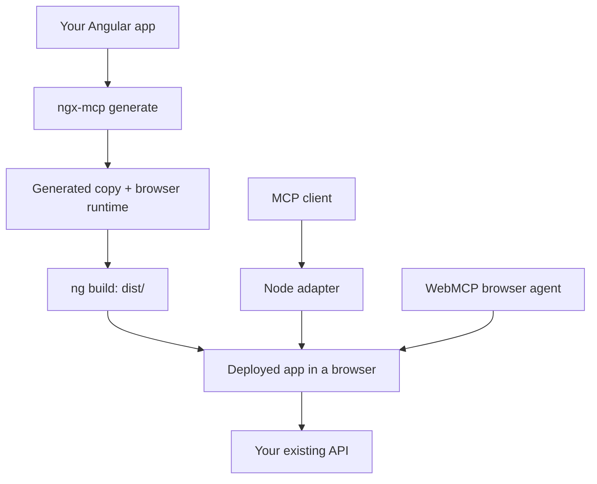

# ngx-mcp

MCP and WebMCP tools for Angular applications.

ngx-mcp reads your app with its installed Angular compiler and adds a browser runtime. Agents can fill fields, submit forms, and activate controls through your app's existing event handlers and validators.

**Experimental alpha.** Use a development backend: tool calls can change data as the signed-in user.

## Getting started

Requires an Angular CLI app with its dependencies installed, and Node.js 22.22.3+ (22.x), 24.15.0+ (24.x), or 26+.

From your app's root folder:

```sh
npm install -D ngx-mcp@alpha
npx playwright install chromium
npx ngx-mcp generate --project tsconfig.app.json --out ../my-app-mcp
```

The generator creates `../my-app-mcp` without editing your original source. The output folder must be new and outside your app. In a workspace with multiple apps, add `--target <project-name>`.

Run the generated app:

```sh
cd ../my-app-mcp
npx ng serve --port 4200
```

For an MCP client that supports local stdio servers, use a configuration like this. Replace the package path with the absolute path to ngx-mcp in your **original** app:

```json
{
  "mcpServers": {
    "my-angular-app": {
      "command": "node",
      "args": [
        "/full/path/to/my-app/node_modules/ngx-mcp/dist/ngx-mcp.js",
        "serve",
        "--base-url", "http://localhost:4200",
        "--headed"
      ]
    }
  }
}
```

Restart the client. A browser opens; sign in to your local app if needed. Ask the agent to list the forms on the page, then try filling and submitting one.

The client gets discovery, editing, submission, click, and drag tools, plus typed tools for supported forms. See the [tool reference](https://github.com/JOELJOSEPHCHALAKUDY/ngx-mcp/blob/main/docs/tools.md).

## WebMCP

For a browser agent that supports WebMCP, generate with `--mode webmcp`:

```sh
npx ngx-mcp generate --project tsconfig.app.json --out ../my-app-webmcp --mode webmcp
```

Serve the generated app as above. Its tools register inside the page; the agent calls them through the browser. This mode requires WebMCP support in both the browser and agent.

Use `--mode both` to enable WebMCP and the Node adapter. The default `--mode mcp` uses the Node adapter shown in the quickstart.

## How it works



The browser runtime ships in your app's `dist/` build. The Node adapter runs as a separate process. Deploy the generated app through your usual hosting pipeline.

## Production

Use the `production` profile before offering agent access to other users. It requires a reviewed access policy and a backend module for session validation, permissions, approvals, and audit storage. Your backend continues to authorize API requests.

Follow the [production guide](https://github.com/JOELJOSEPHCHALAKUDY/ngx-mcp/blob/main/PRODUCTION.md) for the policy, bootstrap module, and deployment commands.

Custom widgets may need adapters. Generated schemas describe UI input; the app and backend still validate business rules. Supported scenarios and known limits are recorded in the [public-project evaluations](https://github.com/JOELJOSEPHCHALAKUDY/ngx-mcp/blob/main/evaluation/production-fresh/README.md).

## Documentation

- [Tools, CLI options, and troubleshooting](https://github.com/JOELJOSEPHCHALAKUDY/ngx-mcp/blob/main/docs/tools.md)
- [Production setup](https://github.com/JOELJOSEPHCHALAKUDY/ngx-mcp/blob/main/PRODUCTION.md)
- [Contributing and tests](https://github.com/JOELJOSEPHCHALAKUDY/ngx-mcp/blob/main/CONTRIBUTING.md)
- [Release checks](https://github.com/JOELJOSEPHCHALAKUDY/ngx-mcp/blob/main/RELEASING.md)

MIT. See [LICENSE](https://github.com/JOELJOSEPHCHALAKUDY/ngx-mcp/blob/main/LICENSE) and [third-party notices](https://github.com/JOELJOSEPHCHALAKUDY/ngx-mcp/blob/main/THIRD_PARTY_NOTICES.md).
