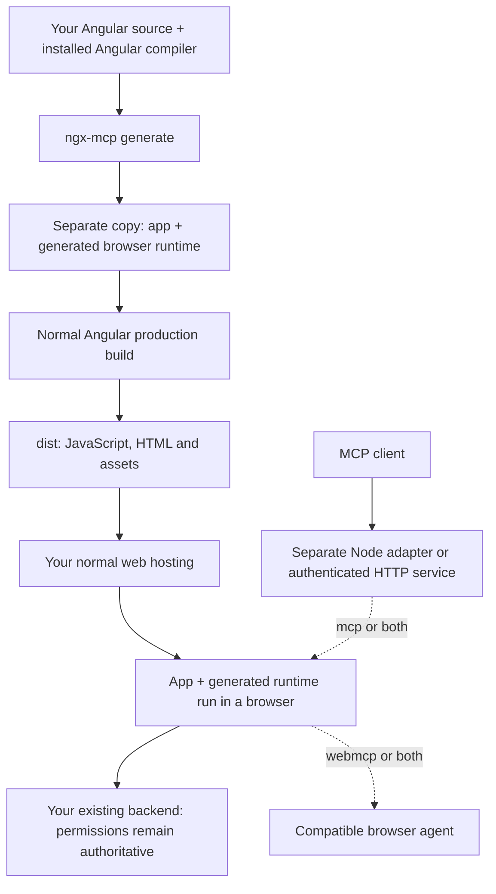

# ngx-mcp

**Let AI agents use your Angular app's real forms and buttons.**

ngx-mcp uses your app's installed Angular compiler to connect tools to live controls. Filling a field or submitting a form runs the app's existing validators, event handlers and API calls. You keep your Angular compiler and normal build process.

The generator writes a separate copy. Your original app stays unchanged.

> **Experimental alpha — `0.1.0-alpha.2`.** Start with synthetic data on a local or staging app. Production access controls require your application's backend integration; see [Production setup](https://github.com/JOELJOSEPHCHALAKUDY/ngx-mcp/blob/main/PRODUCTION.md). Passing the test suite does not establish arbitrary-app compatibility or certify a deployment's security.

## Pick how agents connect

| Generate mode | Connection | What you run |
| --- | --- | --- |
| `mcp` (default) | An MCP client talks to a Node adapter, which drives a browser running your app | Generated Angular app + `ngx-mcp serve`, or an authenticated `ngx-mcp host` service |
| `webmcp` | A compatible browser agent calls tools registered inside the page | Generated Angular app; browser-native WebMCP support is required |
| `both` | Both connections use the same runtime and production policy | Generated app + a Node adapter when using the MCP connection |

WebMCP is experimental. Publishing a website does not automatically let ChatGPT or Claude connect to it. Those products need a supported connection path; browser API tests do not establish product interoperability.

## Try it locally

You need Node.js 22 (22.22.3+), 24 (24.15.0+), or 26+, and an Angular CLI app that already builds with its dependencies installed. See [package.json](https://github.com/JOELJOSEPHCHALAKUDY/ngx-mcp/blob/main/package.json) for exact Node ranges. The generator uses the app's own Angular/TypeScript versions. Compatibility depends on the app and controls; the [evaluation guides](https://github.com/JOELJOSEPHCHALAKUDY/ngx-mcp/blob/main/evaluation/production-fresh/README.md) record the measured scope.

### 1. Install in your Angular app

```sh
cd my-app
npm install -D ngx-mcp@alpha
```

The `alpha` channel targets experimental releases. To pin this release exactly, use `ngx-mcp@0.1.0-alpha.2` instead.

For the Node MCP adapter (`mcp` or `both`), also install its browser:

```sh
npx playwright install chromium
```

### 2. Generate a copy

From your Angular app's folder:

```sh
npx ngx-mcp generate \
  --project tsconfig.app.json \
  --out ../my-app-mcp \
  --mode mcp
```

`--out` must be a new folder outside your app. In a multi-app workspace, add `--target <angular-project-name>`. Use `--mode webmcp` or `--mode both` to choose the other paths.

### 3. Run that copy

```sh
cd ../my-app-mcp
npx ng serve --port 4200
```

### 4. Connect an MCP client

For `mcp` or `both`, add this to your client's MCP configuration:

```json
{
  "mcpServers": {
    "my-angular-app": {
      "command": "node",
      "args": [
        "/full/path/to/my-app/node_modules/ngx-mcp/dist/ngx-mcp.js",
        "serve",
        "--base-url", "http://localhost:4200",
        "--headed"
      ]
    }
  }
}
```

Use the absolute path to the package installed in your original app. Restart the client. A Chromium window opens; log into the app there if necessary. Ask the agent to list the available forms, then try a workflow using synthetic data. For `webmcp`, use a browser agent that supports the native API instead of this Node configuration.

The default `development` profile allows local experimentation without production approval controls. Its actions use the logged-in app session and can change real data. Choose the production profile before offering agent access to other people.

## What gets deployed?



The generated runtime becomes part of the app's normal browser bundle. The Node service is a separate process; it is not hidden inside `dist`. Hosting `dist` enables the selected browser runtime, but does not create a publicly reachable MCP endpoint.

## Production setup

The production profile requires a reviewed, exact-build policy and an owner-written `connectNgxMcpAccess()` module. It defaults to denying tool/data access, revalidates the app session, scopes reads and writes, requires trusted approval for mutations, and sends redacted events to your audit sink. The backend must implement session validation, permission checks, approval and audit storage.

Follow [PRODUCTION.md](https://github.com/JOELJOSEPHCHALAKUDY/ngx-mcp/blob/main/PRODUCTION.md) for the review/generate/deploy workflow, a browser bootstrap contract, remote `serve` configuration and authenticated HTTP hosting. Existing apps deploy a new generated build through their normal pipeline. They do not replace Angular's compiler or expose the old production build retroactively.

## Tools

| Tool | Purpose |
| --- | --- |
| `angular_list_nodes` | List available forms, fields and actions |
| `angular_describe_node` | Describe a selected node; production values need separate read permission |
| `angular_read_model` | Read the permitted Angular model projection |
| `angular_fill`, `angular_submit`, `angular_activate` | Fill fields, submit forms and activate controls |
| `angular_drag` | Drag exact live pointer handles to an exact destination; production requires permission for both endpoints |
| `angular_form_*` | A typed tool for each available form |
| `angular_read_view` | Node adapter page view; production returns permitted metadata only |
| `angular_press_key`, `angular_upload_file` | Node adapter keyboard and upload operations |
| `angular_navigate` | Node adapter navigation in development; disabled in production |

For a large page, start discovery with `{kind: "form", visible: true, includeFields: false}` and describe the selected form to read its fields. Typed form tools are published only when their fields and one visible submit path are supported; use exact generic controls for multi-button forms. Discovery returns at most 100 nodes by default; follow `nextOffset` for more, and restart after a UI change. Descriptors identify the source of each label in `labelSource`; `single-control-context` marks nearby text from an unambiguous field container, rather than an explicit HTML label association.

Only allowed tools and nodes are exposed in production. A successful UI dispatch does not prove that a backend transaction completed; inspect the app's actual result. Browser-native publication covers the shared form and control tools.

- **Editing:** `angular_fill` accepts plain text for `contenteditable`. Use `angular_activate` with `event: "select-all"` on an editor before applying one of its original formatting commands. Runtime discovery observes Angular's public event registrations, so library controls without button roles can advertise their registered events, such as `mousedown`. Choose an event from the descriptor; no component method is called directly.
- **Uploads:** pass `{files: [{name, mimeType, base64}]}` to `angular_fill`. The limit is 512 KiB of decoded data, with up to 16 files when the input allows multiple files. File contents are excluded from discovery and model reads. A hidden input needs a visible associated label or an exact file-picker request observed during an activated UI action; that offer lasts 30 seconds and is consumed on upload.
- **Keyboard:** `angular_activate` with `event: "keyboard", key: "Enter"` dispatches key handlers and native Enter/Space activation on exact focusable controls. It does not provide browser shortcuts, text typing or Tab traversal. Inputs and editors also accept `event: "keydown", key: "Escape"` for dialog dismissal.
- **Navigation and frames:** full page navigation can interrupt an in-page tool response. Observe the destination and rediscover tools there. Same-origin iframe controls use their own documents; cross-origin frames stay outside the registry. Production permissions for a frame host do not grant access to its child controls.

The adapter stabilizes the app's injected Angular zone, then dispatches UI events outside it so original listeners retain their normal change detection and browser default-action timing. Browser restrictions, delegated nonsemantic controls, and custom widgets can still require an adapter.

## Commands

Run `npx ngx-mcp <command> --help` from the app or server folder where you installed the package. For example:

```sh
npx ngx-mcp serve --base-url http://localhost:4200 --headed
```

| Command/option | Meaning |
| --- | --- |
| `generate --project <tsconfig>` | Read the app with its own compiler and stage a new copy |
| `--out <new-dir>` | Output outside the original workspace |
| `--mode mcp\|webmcp\|both` | Choose connections; defaults to `mcp` |
| `--profile development\|production` | Choose access controls; defaults to `development` |
| `--policy <reviewed.json> --access-bootstrap <module.ts>` | Required for production; exact policy/build binding and trusted backend hooks |
| `--target <name>` | Select an Angular project in a multi-app workspace |
| `--build --configuration production` | Build the copy using the app's Angular CLI |
| `--compiler-only` | Skip additional runtime UI-library discovery |
| `serve --base-url <url> --headed` | Connect an MCP client to a running generated app |
| `serve --storage-state <file>` | Use operator-provided Playwright session state; treat the file as a credential |
| `serve --allow-origin <https-origin>` | Explicitly permit a remote production app |
| `serve --allow-network-origin <https-origin>` | Permit a remote app's required API/identity/resource origin; repeat as needed |
| `host --config <server-config.mjs>` | Start authenticated HTTP MCP with server-owned identity/session/audit configuration |

## Troubleshooting and limits

| Problem | Next step |
| --- | --- |
| Compiler/dependency error | Install the app's dependencies and confirm its original production build works. |
| Output already exists | Choose a new output folder. |
| No registry found | Serve the generated copy and check that its browser entry imports the runtime. |
| No native WebMCP tools | Check browser/agent support and selected generation mode. |
| Production catalog is empty | Check owner bootstrap, live session, origin/route policy and exact source IDs. |
| Production generation rejects `buildId` | Regenerate the review manifest with the same bootstrap, review changed IDs/behaviour, then update the policy. |
| A workflow dispatches but does not complete | Check native validation and the backend's result; tool acknowledgement alone is insufficient. |

Custom widgets and app-specific business semantics can need explicit integration. Generated form schemas describe observable UI input, not every backend rule. Browser tool controls supplement existing backend authorization and do not isolate an app from malicious scripts already running in its page.

## Contributing and release evidence

To work on ngx-mcp itself, use the source checkout:

```sh
git clone https://github.com/JOELJOSEPHCHALAKUDY/ngx-mcp.git
cd ngx-mcp
npm ci
npx playwright install chromium
npm run build
npm run test:setup
npm run verify
```

See [RELEASING.md](https://github.com/JOELJOSEPHCHALAKUDY/ngx-mcp/blob/main/RELEASING.md) for native-browser and fresh-project release gates. [Production evaluation](https://github.com/JOELJOSEPHCHALAKUDY/ngx-mcp/blob/main/evaluation/production-fresh/README.md) records pinned public projects and reproducible checks. Earlier reports remain historical evidence for their recorded source snapshots. The older prototype lives under [experiments/source-inference](https://github.com/JOELJOSEPHCHALAKUDY/ngx-mcp/blob/main/experiments/source-inference/README.md) and is excluded from the package.

MIT. See [THIRD_PARTY_NOTICES.md](https://github.com/JOELJOSEPHCHALAKUDY/ngx-mcp/blob/main/THIRD_PARTY_NOTICES.md) for public sample attribution.
