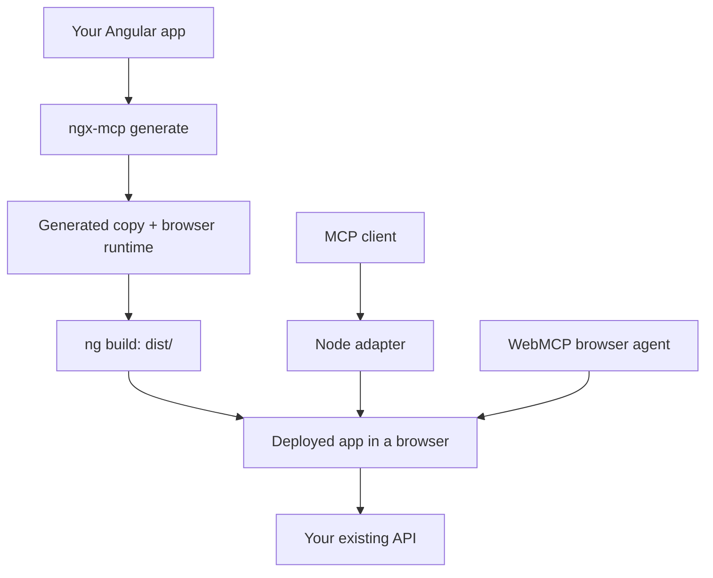

# ngx-mcp

MCP and WebMCP tools for Angular applications.

ngx-mcp reads your app with its installed Angular compiler and adds a browser runtime. Agents can fill fields, submit forms, and activate controls through your app's existing event handlers and validators.

**Experimental alpha.** Use a development backend: tool calls can change data as the signed-in user.

## Getting started

Requires an Angular CLI app with its dependencies installed, and Node.js 22.22.3+ (22.x), 24.15.0+ (24.x), or 26+.

From your app's root folder:

```sh
npm install -D ngx-mcp@alpha
npx playwright install chromium
npx ngx-mcp generate --project tsconfig.app.json --out ../my-app-mcp
```

The generator creates `../my-app-mcp` without editing your original source. The output folder must be new and outside your app. In a workspace with multiple apps, add `--target <project-name>`.

Run the generated app:

```sh
cd ../my-app-mcp
npx ng serve --port 4200
```

For an MCP client that supports local stdio servers, use a configuration like this. Replace the package path with the absolute path to ngx-mcp in your **original** app:

```json
{
  "mcpServers": {
    "my-angular-app": {
      "command": "node",
      "args": [
        "/full/path/to/my-app/node_modules/ngx-mcp/dist/ngx-mcp.js",
        "serve",
        "--base-url", "http://localhost:4200",
        "--headed"
      ]
    }
  }
}
```

Restart the client. A browser opens; sign in to your local app if needed. Ask the agent to list the forms on the page, then try filling and submitting one.

The client gets discovery, editing, submission, click, and drag tools, plus typed tools for supported forms. See the [tool reference](https://github.com/JOELJOSEPHCHALAKUDY/ngx-mcp/blob/main/docs/tools.md).

## Connection modes

| Mode | How the agent connects | What you run |
| --- | --- | --- |
| `mcp` (default) | MCP client → Node adapter → browser | Generated app + `ngx-mcp serve` |
| `webmcp` | Browser agent → WebMCP tools in the page | Generated app in a WebMCP-capable browser |
| `both` | Either connection | Generated app + Node adapter when using MCP |

For a browser agent that supports WebMCP, generate with `--mode webmcp`:

```sh
npx ngx-mcp generate --project tsconfig.app.json --out ../my-app-webmcp --mode webmcp
```

Serve the generated app as above. Its tools register inside the page; the agent calls them through the browser. This mode requires WebMCP support in both the browser and agent.

Use `--mode both` to enable both connections.

## How it works



The browser runtime ships in your app's `dist/` build. The Node adapter runs as a separate process. Deploy the generated app through your usual hosting pipeline.

## Production setup

The production profile requires a reviewed, exact-build policy and an owner-written `connectNgxMcpAccess()` module. It defaults to denying tool/data access, revalidates the app session, scopes reads and writes, requires trusted approval for mutations, and sends redacted events to your audit sink. The backend must implement session validation, permission checks, approval and audit storage.

Follow [PRODUCTION.md](https://github.com/JOELJOSEPHCHALAKUDY/ngx-mcp/blob/main/PRODUCTION.md) for the review/generate/deploy workflow, a browser bootstrap contract, remote `serve` configuration and authenticated HTTP hosting. Existing apps deploy a new generated build through their normal pipeline. They do not replace Angular's compiler or expose the old production build retroactively.

Custom widgets may need adapters. Generated schemas describe UI input; the app and backend still validate business rules. Supported scenarios and known limits are recorded in the [public-project evaluations](https://github.com/JOELJOSEPHCHALAKUDY/ngx-mcp/blob/main/evaluation/production-fresh/README.md).

## Tools

| Tool | Purpose |
| --- | --- |
| `angular_list_nodes` | List available forms, fields and actions |
| `angular_describe_node` | Describe a selected node; production values need separate read permission |
| `angular_read_model` | Read the permitted Angular model projection |
| `angular_fill`, `angular_submit`, `angular_activate` | Fill fields, submit forms and activate controls |
| `angular_drag` | Drag exact live pointer handles to an exact destination; production requires permission for both endpoints |
| `angular_form_*` | A typed tool for each available form |
| `angular_read_view` | Node adapter page view; production returns permitted metadata only |
| `angular_press_key`, `angular_upload_file` | Node adapter keyboard and upload operations |
| `angular_navigate` | Node adapter navigation in development; disabled in production |

For input examples, pagination, uploads, and keyboard operations, see the [tool reference](https://github.com/JOELJOSEPHCHALAKUDY/ngx-mcp/blob/main/docs/tools.md).

## Commands

Run `npx ngx-mcp <command> --help` for the full options.

| Command/option | Meaning |
| --- | --- |
| `generate --project <tsconfig>` | Read the app with its own compiler and stage a new copy |
| `--out <new-dir>` | Output outside the original workspace |
| `--mode mcp\|webmcp\|both` | Choose connections; defaults to `mcp` |
| `--profile development\|production` | Choose access controls; defaults to `development` |
| `--policy <reviewed.json> --access-bootstrap <module.ts>` | Required for production; exact policy/build binding and trusted backend hooks |
| `--target <name>` | Select an Angular project in a multi-app workspace |
| `--build --configuration production` | Build the copy using the app's Angular CLI |
| `--compiler-only` | Skip additional runtime UI-library discovery |
| `serve --base-url <url> --headed` | Connect an MCP client to a running generated app |
| `serve --storage-state <file>` | Use operator-provided Playwright session state; treat the file as a credential |
| `serve --allow-origin <https-origin>` | Explicitly permit a remote production app |
| `serve --allow-network-origin <https-origin>` | Permit a remote app's required API/identity/resource origin; repeat as needed |
| `host --config <server-config.mjs>` | Start authenticated HTTP MCP with server-owned identity/session/audit configuration |

## Documentation

- [Tools, CLI options, and troubleshooting](https://github.com/JOELJOSEPHCHALAKUDY/ngx-mcp/blob/main/docs/tools.md)
- [Production setup](https://github.com/JOELJOSEPHCHALAKUDY/ngx-mcp/blob/main/PRODUCTION.md)
- [Contributing and tests](https://github.com/JOELJOSEPHCHALAKUDY/ngx-mcp/blob/main/CONTRIBUTING.md)
- [Release checks](https://github.com/JOELJOSEPHCHALAKUDY/ngx-mcp/blob/main/RELEASING.md)

MIT. See [LICENSE](https://github.com/JOELJOSEPHCHALAKUDY/ngx-mcp/blob/main/LICENSE) and [third-party notices](https://github.com/JOELJOSEPHCHALAKUDY/ngx-mcp/blob/main/THIRD_PARTY_NOTICES.md).
