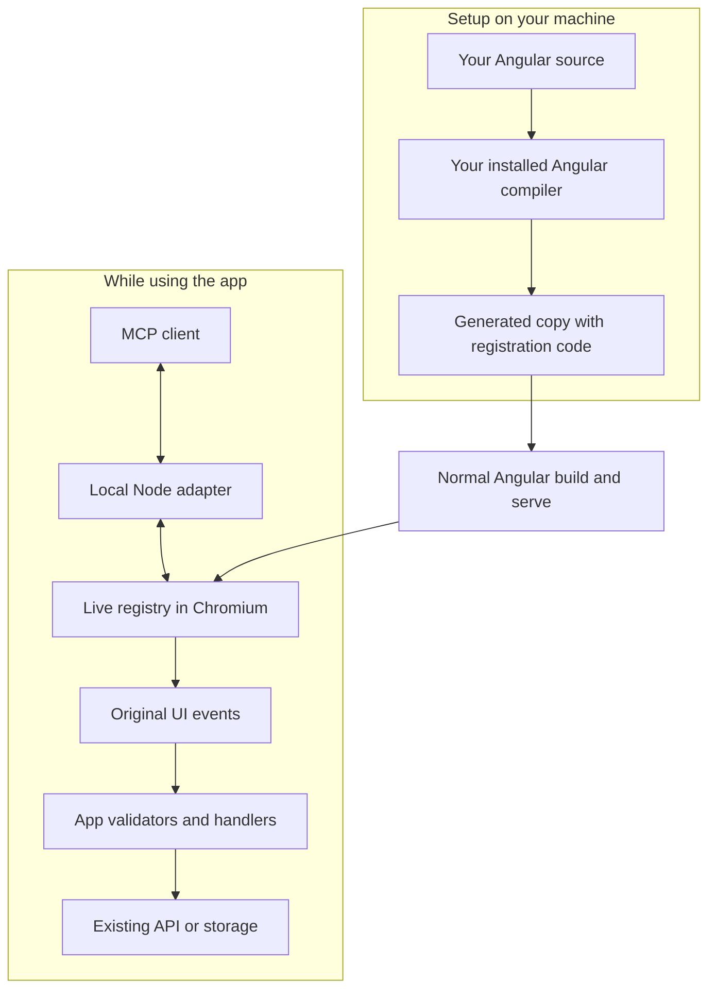

# Angular MCP Compiler

Give an MCP client access to your Angular app's forms and controls through the app's existing UI. It can inspect a page, fill fields, submit forms, and use supported buttons, keyboard interactions, and file inputs.

The integration uses **your app's Angular compiler** to identify controls, then adds a small runtime to a generated copy. Your original application sources remain unchanged. Angular's own validators, handlers, and value accessors still run.

**Status: unpublished alpha.** Use the source-checkout setup below. The current adapter connects to local apps and supports the tested patterns described under [tested scope](#tested-scope).

## Quickstart

### 1. Install the tool

Clone this repository, open its folder, and run:

```sh
npm ci
npm exec playwright install chromium
npm run build
```

Use Node **24.15 or newer on the 24.x line**, or another version allowed by `package.json`. Your Angular app must already have its own dependencies installed and build normally. It needs matching `@angular/core`, `@angular/forms`, `@angular/compiler`, `@angular/compiler-cli`, compatible TypeScript, and its normal Angular CLI. The generated runtime currently needs `@angular/forms` even on screens without forms.

### 2. Generate and run a copy of your app

This example assumes your app and this repository are siblings:

```text
projects/
  angular-mcp-compiler/   ← this repository
  my-app/                ← your existing Angular CLI workspace
  my-app-mcp/            ← generated by the next command
```

From `angular-mcp-compiler`, run:

```sh
npm run integrate -- --project ../my-app/tsconfig.app.json --out ../my-app-mcp
```

Use the application's TypeScript configuration named by its build target in `angular.json`. For a multi-app workspace, this might be `projects/shop/tsconfig.app.json`; add `--target shop` to select the Angular project.

The command prints the generated workspace path, diagnostics, and `angular-mcp.integration.json`. Start **that generated workspace** in another terminal:

```sh
cd ../my-app-mcp
node node_modules/@angular/cli/bin/ng.js serve --host 127.0.0.1 --port 4200
```

For a multi-app workspace, use `serve shop` instead of `serve`. Keep your app's usual API, environment, proxy, and other serve options. The output folder must be new and outside the entire original Angular workspace. The copy links to the original `node_modules`, so keep that installation available. After editing the original app, generate a fresh copy and restart its server.

### 3. Connect your MCP client

Add a **stdio MCP server** to your client. For clients using `mcpServers` JSON configuration:

```json
{
  "mcpServers": {
    "angular-app": {
      "command": "/absolute/path/to/angular-mcp-compiler/node_modules/.bin/node",
      "args": [
        "/absolute/path/to/angular-mcp-compiler/dist/integrated-serve.js",
        "--base-url",
        "http://127.0.0.1:4200",
        "--headed"
      ]
    }
  }
}
```

Replace both executable paths with full paths on your machine; on Windows, use the path to a supported `node.exe`. For a client with a server setup form, enter the same command and arguments there. Restart or reconnect the client after saving.

The client launches the adapter, which opens its **own Chromium browser**. `--headed` lets you watch and log in there; remove it for headless operation. Keep the Angular app server running. `--base-url` is the app URL; MCP communicates over stdio.

Start by asking your client:

> Inspect the current Angular page and list its forms, fields, and available actions. Read the current view before choosing a repeated row.

You should see tools such as `angular_read_view`, `angular_list_nodes`, and `angular_fill`. Supported mounted forms also get `angular_form_*` tools with field schemas. Tool availability follows the currently rendered page.

## How it works



The compiler resolves Angular bindings during setup. The running app registers real control and form references, including distinct IDs for repeated instances. The browser contains the generated runtime; compilation stays on the developer machine.

The default native/ARIA collector also exposes supported UI inside component-library menus and dialogs. Those entries are labelled `runtime-dom`; compiler-resolved entries are labelled `compiler`. Use `--compiler-only` when generating the copy to disable that collector.

## Using the tools

| Need | Tools / behaviour |
| --- | --- |
| Understand the page | `angular_read_view` shows the UI hierarchy and nearby row text; `angular_list_nodes` lists registered targets. |
| Inspect a field or form | `angular_describe_node` reports its current input shape, options, and validation. |
| Enter values and submit | Use a generated `angular_form_*` tool, or `angular_fill` / `angular_submit`. Inputs describe UI values; the app converts them to model values. |
| Operate controls | `angular_activate`, `angular_press_key`, `angular_upload_file`, and `angular_navigate` use the existing UI. |
| Inspect a control model | `angular_read_model` returns bounded plain JSON when available. |

Use the returned schema and current instance IDs. Omitted form fields keep their values. After navigation or rerendering, refresh the view before reusing a target. Ambiguous repeated targets and stale IDs are rejected; opaque custom widgets can remain unsupported.

Interactions use the app's **actual backend and browser session**. A `ui-dispatched` result means the UI interaction ran; check the resulting UI or data to establish business success. Angular evaluates dynamic and cross-field validation at runtime; a tool schema is not a complete business contract.

## Common setup problems

| Problem | What to check |
| --- | --- |
| Angular compiler or dependency error | Install the target app's development dependencies. Use its matching compiler packages and compatible TypeScript. |
| Output directory already exists | Choose a new `--out` path outside the original workspace. |
| Adapter times out waiting for the runtime | Confirm the URL serves the generated copy, inspect its build/browser errors, and review the integration diagnostics. |
| Authentication is missing | Log in using the adapter's headed browser, or add `--storage-state /absolute/path/session.json` with a Playwright storage-state file. Your usual browser session is separate. |
| A field rejects a value | Read its descriptor and schema. Supply the UI representation, such as text or a visible option label, and inspect the app's validation result. |
| The tool targets an old or ambiguous row | Read the view again and select its current exact instance ID. |

The adapter accepts `http` / `https` URLs on `localhost`, `127.0.0.1`, and `[::1]`. This quickstart assumes an Angular CLI workspace; custom build systems need separate verification. For CLI options, use `npm run integrate -- --help` or `npm run mcp:integrated -- --help`.

## Tested scope

Compiler/runtime checks cover specific Angular 16, 20, and 22 toolchains, including optimized AOT builds without Angular debug APIs. They are not a promise of compatibility with every Angular application or widget.

- Three public apps cover finance/Material controls, a reactive todo app, and a PrimeNG/NgRx shopping app: **34/35 positive scenarios and 21/21 rejection, cancellation, and identity checks** using documented UI mappings. Raw business arguments pass **25/35** positives. The remaining positive also fails in the unchanged app. See the [full comparison and source pins](evaluation/integration-unseen/REPORT.md).
- A fourth notes app matches **12/12 native UI/storage snapshots**, including three upstream display failures; four native confirmation decisions remain separate human/UI steps. See the [fourth-project evidence](evaluation/integration-holdout/notes-manager/README.md).

These apps became development examples during shared fixes. The results are finite conformance evidence, not an untouched-project accuracy estimate. Setup and replay instructions live alongside each report.

The original five sample projects, older source-inference commands, and benchmark history are preserved in [EXPERIMENTS.md](EXPERIMENTS.md) in this checkout. For package contents and public release preparation, see [RELEASING.md](RELEASING.md). The package remains private; these instructions do not publish it.

MIT licensed. Public sample attribution is recorded in [THIRD_PARTY_NOTICES.md](THIRD_PARTY_NOTICES.md).
